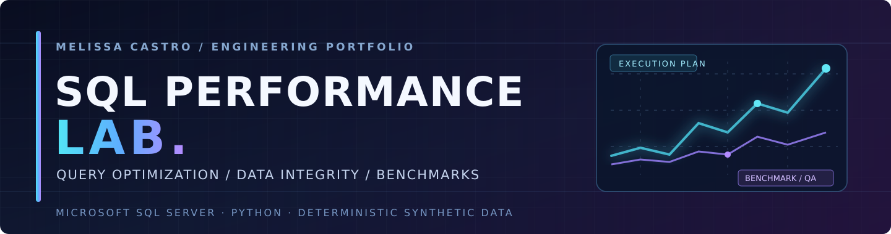
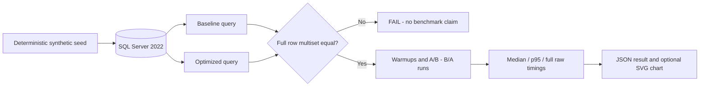

<p align="center">
  
</p>

<p align="center">
  <a href="https://github.com/Dicureck"></a>
  
  
  
</p>

<h3 align="center">Query optimization is only successful when the results stay correct.</h3>

A reproducible **SQL Server performance engineering laboratory** that compares baseline and optimized T-SQL implementations against independently generated synthetic operational data. Built to showcase query reasoning, data integrity, measurement discipline, and production-minded engineering decisions — **not client code or a redacted customer system**.

> **Engineering status: public technical preview (v0.1.0).** GitHub Actions has successfully run both Python static checks and real SQL Server Developer Edition container integration tests with synthetic records. A measured CI smoke benchmark is available in [verified benchmark evidence](docs/verified-ci-benchmark-2026-10-15.md). These results are short, environment-specific observations—not production performance promises.

## Engineering focus

| Track | Baseline pattern | Optimization | Correctness gate |
|:---|:---|:---|:---|
| **01 · Date-range access** | `DATEDIFF` applied to the indexed date column | SARGable half-open interval | Row multiset, complete output |
| **02 · Detail report** | Repeated correlated aggregates per order | One set-based grouped join | Row multiset, including duplicates |

### System design



## Quickstart (local, isolated)

**Prerequisites:** Docker Desktop (x86_64 SQL Server container), Python 3.10+, 4 GB RAM available for the SQL container, and ports `14333` (local only). SQL Server **Developer** edition is for non-production development and testing.

```bash
git clone https://github.com/Dicureck/sql-performance-lab.git
cd sql-performance-lab
cp .env.example .env
# Edit .env and set your own strong SQLLAB_PASSWORD.
docker compose up -d
python -m venv .venv
# Linux/macOS: source .venv/bin/activate
# Windows PowerShell: .venv\Scripts\Activate.ps1
pip install -r requirements-dev.txt
pip install -e .
python -m perf_lab init --customers 12000 --orders 100000 --lines-per-order 3
python -m pytest -q
python -m perf_lab validate
python -m perf_lab benchmark --iterations 7 --warmups 2 --out results/benchmark.json
python scripts/render_benchmark.py results/benchmark.json results/benchmark.svg
```


If your Python is installed directly without `pip install -e .`, use `PYTHONPATH=src python -m perf_lab ...` (Windows: `set PYTHONPATH=src`). A local `.env` file is excluded from Git. For Windows, copy with `Copy-Item .env.example .env`.

To run integration tests against the seeded local database:

```bash
# Linux/macOS
SQLLAB_INTEGRATION=1 python -m pytest -q
# PowerShell: $env:SQLLAB_INTEGRATION='1'; python -m pytest -q
```

**Safety:** `init` deletes and recreates tables **only inside the dedicated local** `SqlPerformanceLab` database. Do not point this code at a production SQL Server; a guard rejects non-loopback hosts and unexpected database names. The dataset is generated, never imported from real records.

## Evidence-first benchmarking

1. Ensure the two queries return **exactly the same rows with the same multiplicity**. SQL `EXCEPT` alone is insufficient because it deduplicates.
2. Run warmups, then alternate baseline/optimized execution order across iterations.
3. Capture client wall-clock time including result transfer; report raw runs, **median**, and **p95**.
4. Repeat on the same hardware, same data, same indexes, same date window; note SQL Server version and caching conditions.
5. Treat an optimization as a *hypothesis*. The query optimizer may transform either version differently; the optimized variant may not always win.

The repository does not pre-populate arbitrary demo performance figures. **One actual CI run** collected [reproducible, environment-specific observations](docs/verified-ci-benchmark-2026-10-15.md); the original JSON is preserved as a [GitHub Actions artifact](https://github.com/Dicureck/sql-performance-lab/actions/runs/38784723221). Further comparisons still require independent runs and execution-plan analysis.

See [benchmark methodology](docs/methodology.md), [query plans](docs/query-plans.md), [case studies](docs/case-studies.md), and [engineering decisions](docs/engineering-decisions.md).

## Repository contents

```text
assets/                    Custom cyber-noir SVG identity
sql/00_schema.sql          Synthetic schema, keys and covering index
sql/01_seed.sql            Deterministic SQL Server seeding procedure
sql/cases/                 Baseline vs optimized query pairs
src/perf_lab/              Safe CLI, result-set validator, benchmark harness
tests/                     Static checks and opt-in SQL Server integration tests
scripts/                   Convert actual benchmark JSON to an SVG comparison chart
docs/                      Architecture, methodology, plan review and decisions
.github/workflows/         CI with container-backed semantic checks
results/                   Local generated results, gitignored
```

## Engineering trade-offs

- An index may benefit one report but increase storage and write costs. This project tests **one explicit access path**, rather than prescribing broad indexing rules.
- Half-open date intervals are equivalent to whole-calendar-day `DATEDIFF` filters **only for the midnight-aligned parameters enforced by the CLI**.
- The grouped-join rewrite assumes every order has at least one line; the synthetic generator enforces this invariant. A real application would require explicit decisions for missing detail rows.
- Integer **cents** avoid floating-point discrepancies in financial-style aggregates.
- Client-side elapsed measurements include network + fetch overhead; capture logical reads and execution plans separately for a deeper diagnosis.

## Ethical boundaries

All names, identifiers, amounts, date patterns, schemas and tests are independently invented. No proprietary stored procedures, production data, client-specific business rules, credentials or internal measurements are included. The project is an **educational engineering reproduction**, not a client deliverable.

## Author

**Melissa Castro** · Data Analytics | Business Intelligence | SQL Engineering & Automation  
[GitHub profile](https://github.com/Dicureck) · Guatemala

<sub>Design language: charcoal / electric cyan / violet · Built for reproducibility, not vanity metrics.</sub>
