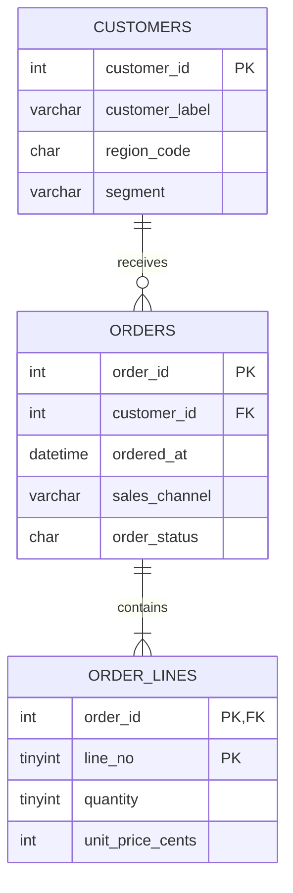

# Architecture and data contract

## Dataset

Three normalized, synthetic tables under the **`lab`** schema:

| Table | Purpose | PK / relationships | Default cardinality |
| --- | --- | --- | ---: |
| `lab.customers` | Artificial customer dimensions, segment, region | `customer_id` | 12,000 |
| `lab.orders` | Artificial time-stamped channel orders, status, shipping | `order_id`; FK to customer | 100,000 |
| `lab.order_lines` | Artificial quantities and integer-cent prices | `(order_id, line_no)`; FK to order | 300,000 |
| `lab.seed_manifest` | Seed configuration and UTC timestamp | `manifest_id=1` | 1 |

The numeric seed generation is entirely deterministic: six digits are combined into unique values 1..1,000,000; all derived attributes use integer arithmetic, case expressions and a fixed 2024 time window. There is no `NEWID`, `RAND`, external API, private data, or real-world person in the dataset.

## Integrity invariants

- Every `orders.customer_id` maps to `customers.customer_id`.
- Every line maps to an existing order.
- Every order has exactly `lines_per_order` lines, ranging from one to five.
- `order_status='C'` means a completed synthetic order and `'X'` an excluded order.
- Aggregates convert quantity to `BIGINT` before multiplying prices in integer cents.
- All benchmark start/end parameters are whole ISO calendar dates, interpreted as `[start, end)`.

## Boundaries

- Port `127.0.0.1:14333` is bound to the developer's machine only.
- The Python configuration rejects anything other than `localhost`, `127.0.0.1` or `::1`.
- DB is hard-coded to `SqlPerformanceLab` to avoid execution against operational DBs.
- `init` is intentionally destructive **within that database** and fully rebuilds the demo schema; it must not be run with existing work in that database.
- The service uses Developer edition and must not be used for production workloads.

## Mermaid ER diagram

